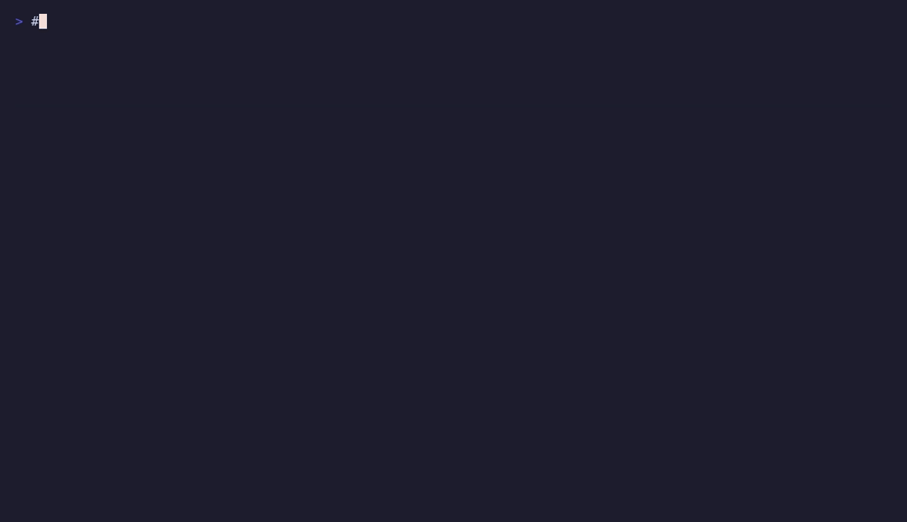

<div align="center">

# 🧩 ai-stack — a complete local AI stack on AMD (no NVIDIA, no CUDA, no cloud)

### Run your own LLM chat, web search, image generation, browser automation, and a sandboxed security lab — 100% self-hosted on an **AMD Radeon** GPU with **ROCm**.


-ED1C24)


</div>

> **Run LLMs locally on AMD.** A private, offline-capable AI platform — a self-hosted
> ChatGPT-style assistant, local Stable-Diffusion-style image generation, and
> AI tool-use — built entirely on **AMD ROCm**. No NVIDIA card, no CUDA, no API
> keys, no subscription. One GPU, one `git clone`, one script.

<div align="center">

</div>

## Why AMD? (the short version)

Running large models usually means paying the NVIDIA premium. You don't have to.
Modern **AMD Radeon** cards ship with a lot of VRAM per dollar, and the open
**ROCm** stack now runs llama.cpp, ComfyUI and the whole local-AI toolchain well —
*if* someone has already worked out the images, flags and VRAM juggling. This repo
is that work, done and reproducible:

- ✅ **No CUDA, no vendor lock-in** — every service runs on ROCm.
- ✅ **More VRAM for your money** — a 32 GB card runs a 27B chat model *and* image
  generation (see [VRAM handoff](#the-interesting-part-vram-handoff)).
- ✅ **Private & offline** — nothing leaves your machine; all ports bind to `127.0.0.1`.
- ✅ **Turnkey** — clone, run `install.sh`, pull models, `systemctl start`.

## What you get

| Capability | How |
|---|---|
| 💬 **Local LLM chat** (private ChatGPT alternative) | Open WebUI + llama.cpp/llama-swap, OpenAI-compatible API |
| 🔎 **Web search in chat** | SearXNG + an MCP search tool |
| 🎨 **Image generation & vision** | ComfyUI (Qwen-Image) on ROCm, called from chat |
| 🌐 **Browser automation** | Playwright MCP (headless Chromium) |
| 🛡️ **Sandboxed security lab** | Kali toolbox over MCP, network-egress-pinned |
| ♻️ **Supervised & reproducible** | rootless Podman + systemd, portable `compose.yaml` |

## Hardware

Built and tuned on the **AMD Radeon AI PRO R9700** (32 GB, RDNA4, `gfx1201`) with
**ROCm**. It should port to other ROCm-supported Radeon cards by adjusting the
image targets and `.env` — the architecture is GPU-agnostic; only the two local
image tags (`llamacpp-rocm`, `comfyui-rocm`) are built for `gfx1201`.

## Architecture

```
                 ┌───────────────── Open WebUI (chat UI) ─────────────────┐
  you  ──────►   │  default model: Qwen3.8-27B (local, ROCm)              │
                 └───┬───────────────┬───────────────┬───────────────┬────┘
                     │ /v1 (chat)    │ MCP           │ MCP           │ MCP
                     ▼               ▼               ▼               ▼
                  llm            mcp-search     playwright-mcp     kali-mcp
               (llama-swap)         │                               │ podman.sock
               GGUF on demand       ▼                               ▼  (exec)
               ROCm / gfx1201     searxng                      kali-sandbox
                                                            (egress-pinned lab)

  comfyui (image gen, ROCm) is invoked by Open WebUI tools; llama-swap frees
  VRAM first so the diffusion pipeline fits. Everything binds to 127.0.0.1.
```

## Quick start

**Prerequisites:** an AMD ROCm GPU (tuned for the R9700 / `gfx1201`), rootless
Podman + `podman-compose`, and the local images built (`llamacpp-rocm`,
`comfyui-rocm`, and the Kali sandbox via `services/kali-mcp/scripts/build.sh`).

```bash
git clone https://github.com/wildcommitter/ai-stack.git && cd ai-stack
./scripts/install.sh                 # writes .env + secrets, installs systemd units, makes the volume
$EDITOR .env                         # GPU GIDs, model paths
./download-model.sh all <HF_TOKEN>   # fetch models (sha256-verified) into your model dirs
systemctl --user start ai-stack.service
```

Open **http://localhost:3000** and chat. `download-model.sh list` shows the model
catalog; downloads are resumable and checksum-verified.

## The interesting part: VRAM handoff

A 32 GB card holds a 27B LLM (~28 GB with KV cache) *or* an image pipeline — not
both. ai-stack treats VRAM as shared: `llama-swap` loads the chat model on demand
and unloads it after an idle timeout, and the image tool unloads the LLM before a
ComfyUI job and frees it afterward. One GPU, many workloads, no out-of-memory, no
manual juggling. Details in [`config/llama-swap.yaml`](config/llama-swap.yaml).

## FAQ

**Can I run a local LLM on an AMD GPU without NVIDIA/CUDA?**
Yes — that's the whole point. Every component here runs on AMD ROCm.

**Is this a self-hosted, private ChatGPT alternative?**
Yes. Open WebUI gives you a familiar chat interface over a local model; nothing
leaves your machine and there are no API keys or usage fees.

**Does it do local image generation (like Stable Diffusion) too?**
Yes, via ComfyUI on ROCm, callable directly from the chat.

**What AMD GPU do I need?**
Developed on the Radeon AI PRO R9700 (32 GB, RDNA4). Other ROCm cards should work
with image-target and `.env` tweaks; more VRAM lets you run larger models.

**How do I keep the LLM and image model from running out of VRAM?**
They don't coexist — llama-swap and the image tool hand VRAM back and forth
automatically. See [VRAM handoff](#the-interesting-part-vram-handoff).

**Can an AI agent use tools here?**
Yes — web search, a headless browser, and a sandboxed shell are exposed as MCP
servers, usable from Open WebUI or any MCP-aware client.

## Repository layout

```
ai-stack/
├── compose.yaml          # the whole stack (portable paths via .env)
├── download-model.sh     # checksum-verified Hugging Face model fetcher
├── config/               # llama-swap + searxng config
├── services/             # llm, comfyui, mcp-search, kali-mcp (each buildable)
├── systemd/              # supervised boot units
├── scripts/install.sh    # one-shot host setup
└── AGENTS.md             # technical source of truth / contributor guide
```

## Security & responsible use

The Kali component is for **learning and authorized testing only** — standard,
openly-available tooling inside a network-isolated container. Use it only on
systems you own or have explicit permission to test. Secrets are generated
locally and never committed; model weights live outside the repo.

## License

[MIT](LICENSE).

---

<div align="center">
<sub>Local-first AI on AMD ROCm — self-hosted LLM chat, image generation and agent tools, no CUDA required.</sub>
</div>
